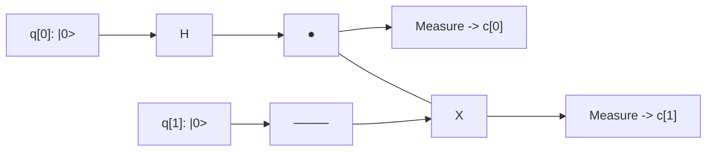

# Tutorial 2: Quantum Entanglement & Bell States

Quantum entanglement is one of the definitive phenomena distinguishing quantum from classical computation. In an entangled state, the quantum states of two or more particles cannot be described independently of the state of the others, regardless of spatial separation.

In this tutorial, you will generate and measure a canonical **Bell State** ($|\Phi^+\rangle$) using the Quantum Virtual Machine (QVM).

---

## 🎯 Learning Objectives

1. Understand mathematical state evolution through multi-qubit tensor products.
2. Build an entanglement circuit using the Hadamard ($H$) and Controlled-NOT ($CX$) gates.
3. Verify perfect correlations analytically and through shot-based measurement sampling.
4. Execute the circuit via QVM Python IR, OpenQASM, the CLI, and the REST API.
5. Cross-validate the circuit against Qiskit and Cirq backends.

---

## 🔬 Theory & Step-by-Step State Evolution

The Bell state $|\Phi^+\rangle$ is defined as:

$$|\Phi^+\rangle = \frac{|00\rangle + |11\rangle}{\sqrt{2}}$$

Let us trace the quantum state vector as it moves through the circuit:



### Step 0: Initialization
Both qubits begin in the ground state $|0\rangle$:

$$|\psi_0\rangle = |0\rangle \otimes |0\rangle = |00\rangle = \begin{pmatrix} 1 \\ 0 \\ 0 \\ 0 \end{pmatrix}$$

### Step 1: Hadamard on Qubit 0
Applying $H$ to qubit 0 creates an equal superposition on wire 0 while leaving wire 1 unchanged ($H \otimes I$):

$$|\psi_1\rangle = (H \otimes I)|00\rangle = \frac{|0\rangle + |1\rangle}{\sqrt{2}} \otimes |0\rangle = \frac{|00\rangle + |10\rangle}{\sqrt{2}} = \frac{1}{\sqrt{2}}\begin{pmatrix} 1 \\ 0 \\ 1 \\ 0 \end{pmatrix}$$

### Step 2: Controlled-NOT ($CX$) from Qubit 0 to Qubit 1
The $CX$ gate flips the target qubit (qubit 1) if and only if the control qubit (qubit 0) is $|1\rangle$:

$$CX = \begin{pmatrix} 1 & 0 & 0 & 0 \\ 0 & 1 & 0 & 0 \\ 0 & 0 & 0 & 1 \\ 0 & 0 & 1 & 0 \end{pmatrix}$$

Applying $CX_{0 \to 1}$ gives:

$$|\psi_2\rangle = CX|\psi_1\rangle = \frac{1}{\sqrt{2}}\left(CX|00\rangle + CX|10\rangle\right) = \frac{|00\rangle + |11\rangle}{\sqrt{2}} = \frac{1}{\sqrt{2}}\begin{pmatrix} 1 \\ 0 \\ 0 \\ 1 \end{pmatrix}$$

### Measurement Probabilities
Evaluating probability $P(x) = |\langle x | \psi_2 \rangle|^2$:
*   $P(00) = |1/\sqrt{2}|^2 = 0.5$
*   $P(01) = 0.0$
*   $P(10) = 0.0$
*   $P(11) = |1/\sqrt{2}|^2 = 0.5$

Measuring qubit 0 immediately determines qubit 1: if qubit 0 collapses to $0$, qubit 1 is guaranteed to be $0$; if qubit 0 collapses to $1$, qubit 1 is guaranteed to be $1$.

---

## 💻 Python Implementation

```python
from qvm.ir import QuantumCircuit
from qvm.simulator import Simulator
from qvm.parser import OpenQASM2Parser

# Define Bell state in OpenQASM
QASM = """
OPENQASM 2.0;
include "qelib1.inc";

qreg q[2];
creg c[2];

h q[0];
cx q[0], q[1];

measure q[0] -> c[0];
measure q[1] -> c[1];
"""

# Parse into QVM Intermediate Representation
bell_circuit = OpenQASM2Parser.parse(QASM)

# 1. Exact simulation
sim = Simulator()
state, mem = sim.simulate(bell_circuit)
probs = (abs(state) ** 2).round(3)
print("Exact probabilities [00, 01, 10, 11]:", probs)

# 2. Sample 2,000 shots
counts = sim.sample(bell_circuit, shots=2000, seed=42)
print("Sampled counts:", sorted(counts.items()))

# Verification: only '00' and '11' can appear in an ideal simulation
assert set(counts.keys()) <= {"00", "11"}, "Violation of entanglement correlation!"
print("Bell state successfully verified!")
```

### Verified Output
```text
Exact probabilities [00, 01, 10, 11]: [0.5 0.  0.  0.5]
Sampled counts: [('00', 986), ('11', 1014)]
Bell state successfully verified!
```

---

## 🔄 Cross-Framework Export (Qiskit & Cirq)

QVM provides a bidirectional bridge. Any QVM circuit converts directly to native Qiskit `QuantumCircuit` and Cirq `Circuit` objects:

```python
# Convert to Qiskit
qiskit_circ = bell_circuit.to_qiskit()
print("Qiskit ops:", qiskit_circ.count_ops())

# Convert to Cirq
cirq_circ = bell_circuit.to_cirq()
print("Cirq ops count:", len(list(cirq_circ.all_operations())))

# Execute directly on Qiskit Aer via QVM helper
aer_counts = bell_circuit.run_qiskit_simulator(shots=1000)
print("Aer counts:", aer_counts)
```

---

## 🌐 Running via the REST API (`/run`)

You can execute this Bell-state simulation via the FastAPI endpoint:

```bash
curl -X POST "http://127.0.0.1:8000/run" \
  -H "Content-Type: application/json" \
  -d '{
    "source_type": "json",
    "nqubits": 2,
    "circuit": [
      {"name": "h", "qubits": [0]},
      {"name": "cx", "qubits": [0, 1]},
      {"name": "measure", "qubits": [0], "register": "c", "cbit": 0},
      {"name": "measure", "qubits": [1], "register": "c", "cbit": 1}
    ],
    "transpile": true,
    "routing": "sabre",
    "shots": 1000,
    "seed": 42
  }'
```

### Response Highlights
*   `probabilities`: `[0.5, 0.0, 0.0, 0.5]`
*   `counts`: `{"00": 498, "11": 502}`
*   `circuit_plot`: Base64 PNG showing the routed circuit.
*   `histogram_plot`: Base64 PNG with 50/50 bars on `00` and `11`.

---

## 🖥️ Running in the Web Dashboard

1. Start the web application: `npm run dev` in `web/` (or visit the deployed dashboard).
2. Enter the OpenQASM 3.0 snippet:
   ```qasm
   OPENQASM 3.0;
   include "stdgates.inc";
   qubit[2] q;
   bit[2] c;
   h q[0];
   cx q[0], q[1];
   c[0] = measure q[0];
   c[1] = measure q[1];
   ```
3. In the right control panel, set **Shots** to `1000`.
4. Click **Run**.
5. Observe the probability histogram: two equal spikes at `00` and `11`.

Next tutorial: [Tutorial 3: Grover's Search Algorithm](/docs/730_Tutorial_Grovers_Algorithm).
