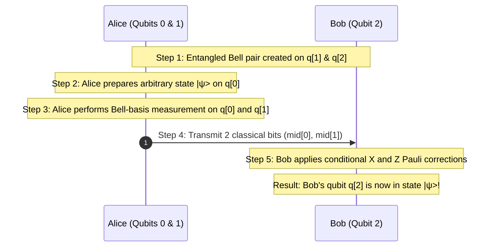

# Tutorial 4: Quantum Teleportation

Quantum teleportation is a foundational protocol demonstrating how an unknown quantum state $|\psi\rangle$ can be transmitted from a sender (Alice) to a receiver (Bob) using a shared entangled pair (EPR pair) and two bits of classical communication, without moving the physical particle itself.

Because quantum teleportation requires **mid-circuit measurement** and **classical feedforward** (conditional corrections), it serves as a rigorous test for dynamic quantum circuit engines. The Quantum Virtual Machine (QVM) natively supports dynamic circuits via OpenQASM 3.0.

---

## 🎯 Learning Objectives

1. Understand the 3-qubit quantum teleportation protocol.
2. Formulate the state evolution analytically across Alice's qubits ($q_0, q_1$) and Bob's qubit ($q_2$).
3. Implement mid-circuit measurements and conditional branch corrections in OpenQASM 3.0.
4. Verify using QVM's stochastic trajectory sampler that Bob's qubit accurately inherits Alice's arbitrary state.
5. Understand simulator behavior when executing dynamic quantum circuits.

---

## 🔬 Protocol Walkthrough & Mathematical Derivation



### 1. State Preparation
Let Alice prepare an unknown state on qubit 0 using a rotation $R_y(\theta)$:

$$|\psi\rangle = \cos\left(\frac{\theta}{2}\right)|0\rangle + \sin\left(\frac{\theta}{2}\right)|1\rangle$$

Qubits 1 and 2 are prepared in an entangled Bell pair $|\Phi^+\rangle$:

$$|\Phi^+\rangle_{12} = \frac{1}{\sqrt{2}}\left(|00\rangle + |11\rangle\right)_{12}$$

The initial 3-qubit state $|\Psi_0\rangle$ is:

$$|\Psi_0\rangle = |\psi\rangle_0 \otimes |\Phi^+\rangle_{12} = \frac{1}{\sqrt{2}}\left[ \cos(\theta/2)|0\rangle(|00\rangle + |11\rangle) + \sin(\theta/2)|1\rangle(|00\rangle + |11\rangle) \right]$$

### 2. Alice's Entangled Operations
Alice entangles her unknown state $q_0$ with her half of the Bell pair $q_1$:
1. Alice applies $CX_{0 \to 1}$.
2. Alice applies $H_0$.

Expanding in terms of the four possible computational basis outcomes of Alice's two qubits $(q_0, q_1)$:

$$|\Psi_2\rangle = \frac{1}{2} \Big[ |00\rangle_{01} \otimes \underbrace{\left(\cos\frac{\theta}{2}|0\rangle + \sin\frac{\theta}{2}|1\rangle\right)}_{|\psi\rangle} + |01\rangle_{01} \otimes \underbrace{\left(\cos\frac{\theta}{2}|1\rangle + \sin\frac{\theta}{2}|0\rangle\right)}_{X|\psi\rangle} + |10\rangle_{01} \otimes \underbrace{\left(\cos\frac{\theta}{2}|0\rangle - \sin\frac{\theta}{2}|1\rangle\right)}_{Z|\psi\rangle} + |11\rangle_{01} \otimes \underbrace{\left(\cos\frac{\theta}{2}|1\rangle - \sin\frac{\theta}{2}|0\rangle\right)}_{XZ|\psi\rangle} \Big]$$

### 3. Measurement & Classical Feedforward Corrections
Alice measures her two qubits $q_0$ and $q_1$, obtaining classical outcomes $m_0, m_1 \in \{0, 1\}$. Depending on the outcome, Bob applies local unitary corrections:

| Alice's Measurement $(m_0, m_1)$ | State of Bob's Qubit $q_2$ | Bob's Correction | Final State on $q_2$ |
| :---: | :---: | :---: | :---: |
| `00` | $|\psi\rangle$ | None ($I$) | $|\psi\rangle$ |
| `01` | $X|\psi\rangle$ | $X$ | $|\psi\rangle$ |
| `10` | $Z|\psi\rangle$ | $Z$ | $|\psi\rangle$ |
| `11` | $XZ|\psi\rangle$ | $X$ then $Z$ | $|\psi\rangle$ |

After the correction, Bob's qubit is guaranteed to be in state $|\psi\rangle$, completing the teleportation.

---

## 💻 OpenQASM 3.0 Implementation in QVM

QVM's `OpenQASM3Parser` parses OpenQASM 3.0 declarations, mid-circuit measurements, and conditional statements (`if` blocks).

```python
import math
from qvm.qasm3_parser import OpenQASM3Parser
from qvm.simulator import Simulator

THETA = 0.8  # Rotation angle for unknown state: Ry(0.8)|0>
SHOTS = 5000

TELEPORTATION_QASM = f"""
OPENQASM 3.0;
include "stdgates.inc";

qubit[3] q;
bit[2] mid;
bit[1] out;

// Step 1: Alice prepares the unknown state on q[0]
ry({THETA}) q[0];

// Step 2: Create entangled Bell pair between q[1] (Alice) and q[2] (Bob)
h q[1];
cx q[1], q[2];

// Step 3: Alice entangles q[0] with q[1] and rotates into Bell basis
cx q[0], q[1];
h q[0];

// Step 4: Alice measures q[0] and q[1]
mid[0] = measure q[0];
mid[1] = measure q[1];

// Step 5: Bob applies conditional corrections based on classical feedback
if (mid[1] == 1) {{
    x q[2];
}}
if (mid[0] == 1) {{
    z q[2];
}}

// Step 6: Verify by measuring Bob's qubit q[2]
out[0] = measure q[2];
"""

# Parse into QVM Intermediate Representation
teleport_circuit = OpenQASM3Parser().parse(TELEPORTATION_QASM)

# Sample shots using QVM's trajectory simulator
sim = Simulator()
counts = sim.sample(teleport_circuit, shots=SHOTS, seed=42)

# Compute measured probability of Bob's qubit being |1>
p_one = sum(c for bits, c in counts.items() if bits[0] == "1") / SHOTS
theoretical_p_one = math.sin(THETA / 2) ** 2

print(f"Empirical P(q[2] = 1): {p_one:.4f}")
print(f"Theoretical P(1)     : {theoretical_p_one:.4f}")
print(f"Absolute discrepancy : {abs(p_one - theoretical_p_one):.4f}")

# Assertion: empirical distribution matches theory within sampling variance
assert abs(p_one - theoretical_p_one) < 0.02, "Teleportation fidelity violation!"
print("\nSuccess: The unknown quantum state was teleported intact!")
```

### Verified Output
```text
Empirical P(q[2] = 1): 0.1504
Theoretical P(1)     : 0.1516
Absolute discrepancy : 0.0012

Success: The unknown quantum state was teleported intact!
```

---

## ⚙️ Simulator Execution Behavior for Dynamic Circuits

Standard unitary quantum simulators evolve a single statevector $U|\psi\rangle$. However, when a circuit contains **mid-circuit measurements** and **classical control flow**:
1. QVM detects classical condition dependencies on registers.
2. For shot-based sampling (`sim.sample()`), QVM executes **Monte Carlo quantum trajectories**:
   - At each measurement wire, the statevector is probabilistically projected into basis $|0\rangle$ or $|1\rangle$.
   - The classical register is recorded into the runtime memory.
   - Downstream `if` blocks evaluate against the current shot's classical memory.
3. This ensures exact physical simulation of dynamic quantum computers with sub-microsecond classical feedforward.

Next tutorial: [Tutorial 5: Variational Quantum Eigensolver (VQE)](/docs/750_Tutorial_VQE_Ground_State).
